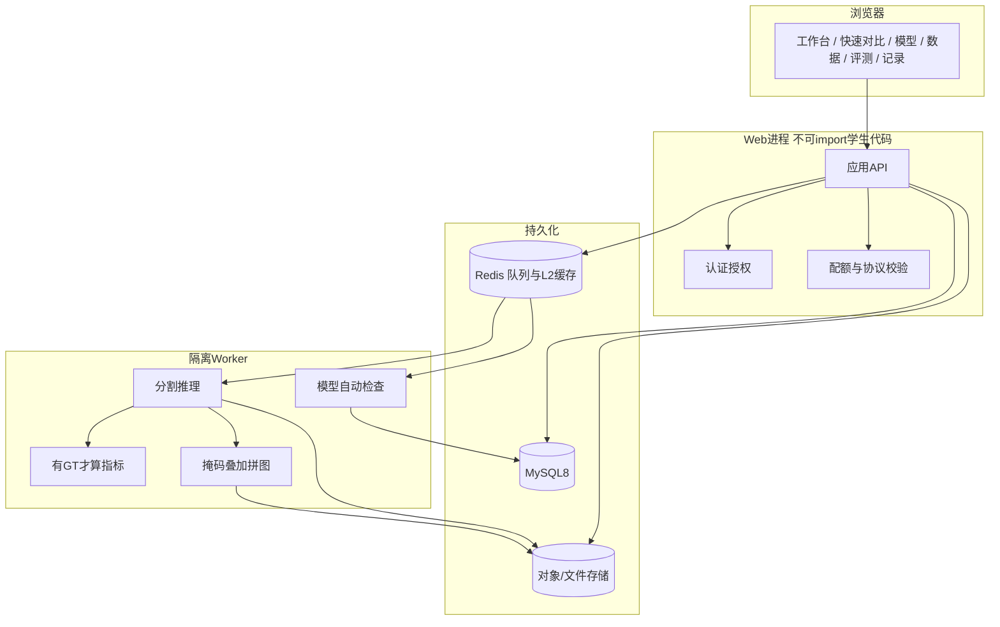
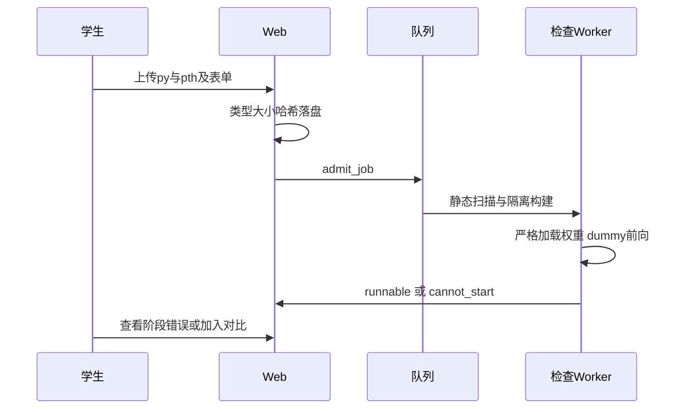
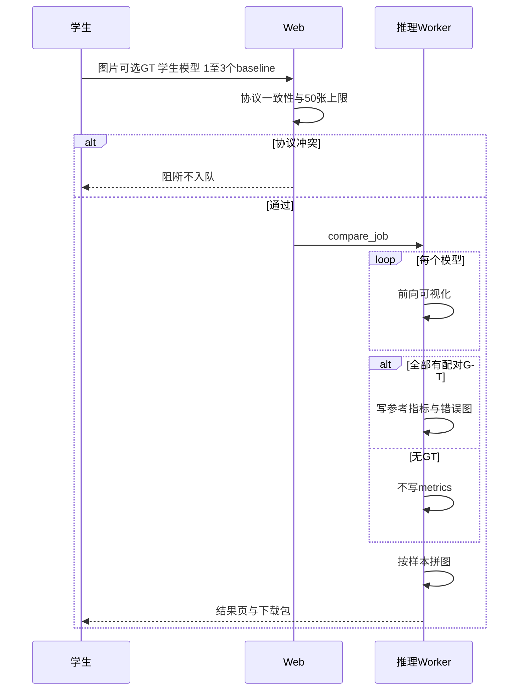
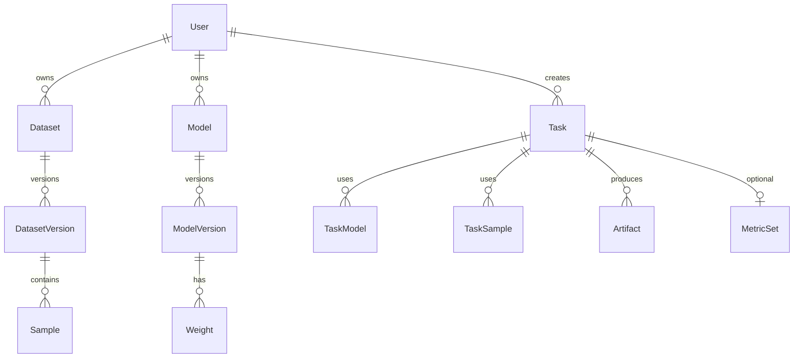

# 课题组工业缺陷分割科研平台概要设计书

文档状态：概要设计（编码前）  
版本：1.0  
日期：2026-09-14  
依据：[课题组网站需求分析书 v2.0](../requirements/课题组网站需求分析书.md)  
本阶段不编码、不定生产库版本、不定云厂商合同。容量、并发、时延目标为 UNKNOWN，实现前实测后再写入。

---

## 1. 设计目标与边界

把需求分析落成可实施的模块、数据对象、主流程和接口轮廓，使后续在**新文件夹独立编码**时不必回头猜需求。

设计必须遵守：

- 常驻网站；不做在线训练；不调用 `train_multi.py` / `train.py`。
- 核心闭环：导入已训模型 → 快速对比 → 可选正式评测 → 下载拼图。
- 学生 `.py` 不在 Web 进程内执行。
- 无 GT 不产生精度字段。
- 无论文出图工作台；导出供 Draw.io 使用的 PNG 图层。
- 企业网站不在本设计范围内。

未知项保持 UNKNOWN：用户规模、峰值并发、服务器型号、公网/内网、LLM 供应商、对象存储品牌、精确配额数字。

---

## 2. 架构选项与推荐

### 选项 A（推荐）：常驻模块化单体 + 同机隔离 Worker

```text
浏览器
  → Web 应用（账号、页面、API、元数据）
  → 本地任务队列
  → Worker 进程/容器（模型检查、推理、评测、拼图）
  → 文件存储（图片、权重、可视化）
  → 关系库（用户、模型、任务元数据）
```

适用：课题组第一版、人数少、一台长期在线 CPU 服务器。  
不应使用：需要多机扩缩、或必须把推理放到独立 GPU 集群时（可平滑拆出 Worker）。

### 选项 B（备选）：Web 与 Worker 分机

Web 常驻；推理 Worker 可在有 GPU 的机器上。队列与对象存储必须持久化。  
适用：第一版之后接入 CUDA 模型。  
不应使用：尚无第二台机器、且第一版只跑 CPU baseline 时（过度拆分）。

### 选项 C（拒绝）

把网站部署在 AutoDL 实例上。实例关机则账号、历史对比、二期知识库全部不可用，与 R-05 冲突。

**第一版按选项 A 实现，技术栈已冻结为：** FastAPI + Vue 3 + MySQL 8 + Redis（RQ 队列与多级缓存）+ Docker 跑学生代码。详见 [课题组网站技术选型](课题组网站技术选型.md)。

---

## 3. 逻辑架构



信任边界：

- Web 只读写元数据与用户上传文件，不 `import` 用户 `.py`。
- Worker 以非特权用户运行，无网络（第一版），只挂载本任务目录。
- 预置数据集只读；学生私有数据按 owner 隔离。
- 固定测试集的 GT 不对普通学生提供下载接口。

---

## 4. 模块划分

| 模块 | 职责 | 第一版 |
|------|------|--------|
| M-WEB | 页面与静态资源 | 必做 |
| M-AUTH | 登录、角色（学生/导师）、会话 | 必做 |
| M-USER | 用户、配额、公告 | 必做 |
| M-DATA | 数据集版本、校验、划分、预览 | 必做 |
| M-MODEL | 内置 baseline、学生导入、模型卡 | 必做 |
| M-ADMIT | `.py`+`.pth` 自动检查状态机 | 必做 |
| M-TASK | 快速对比/正式评测任务编排 | 必做 |
| M-INFER | 无 GT / 有 GT 推理 | 必做 |
| M-METRIC | 仅有 GT 时写指标 | 必做 |
| M-VIZ | 彩色掩码、叠加、边界、错误图、拼图 | 必做 |
| M-REC | 结果查询、再跑、分享、打包下载 | 必做 |
| M-AI | 基于当次结果的分析（证据包） | 可后置于 M-VIZ 稳定之后 |
| M-PLACE | 检测/分类占位页 | 必做（无后端任务） |
| M-KB / M-PAPER | 知识库、顶刊检索 | 二期 |
| M-TRAIN | 在线训练 | **不实现** |

现有研究代码复用位置（复制或作为只读依赖进新仓库，不在网页进程改路径跑训练）：

- 内置网络：`code/compare/`
- checkpoint 重建思路：`code/eval.py` 的 `build_model_from_checkpoint`
- 指标：`code/utils_losses_metrics.py`
- 着色：`code/eval.py` 的 `get_color_map` / `colorize_mask`

必须新建：无掩码 Dataset、对比拼图、插件加载器、Web/任务层。

---

## 5. 页面结构

| 路由意图 | 页面 | 说明 |
|----------|------|------|
| `/` | 工作台 | 最近任务、模型检查状态、三个入口 |
| `/compare/new` | 新建快速对比 | 上传 ≤50 图、可选 GT、选模型 |
| `/compare/:taskId` | 对比结果 | 拼图、切换视图、下载；无 GT 不渲染精度区 |
| `/datasets` | 数据集列表 | 预置/私有/共享 |
| `/datasets/:id` | 数据详情 | 概览、校验报告、版本 |
| `/models` | 模型中心 | 内置 + 我的导入 |
| `/models/import` | 导入模型 | `.py` `.pth` 与元数据表单 |
| `/models/:id` | 模型卡 | 检查日志、可运行状态 |
| `/eval/new` | 新建正式评测 | 选数据版本 + 模型列表 |
| `/eval/:taskId` | 评测结果 | 指标表 + 抽样拼图 |
| `/records` | 结果记录 | 筛选、再跑、下载包 |
| `/assistant` | 科研助手 | 绑定某个 taskId；无证据则拒答 |
| `/detection` `/classification` | 占位 | 文案 + disabled |
| `/admin` | 系统管理 | 仅导师 |

无 `/train`。下载走授权 URL，不暴露存储绝对路径。

---

## 6. 核心流程

### 6.1 导入模型



状态：`uploaded → checking → runnable | cannot_start | retired`

`cannot_start` 必须带 `fail_stage`：`file` / `static` / `import` / `build` / `load` / `forward` / `shape` / `resource`。

### 6.2 快速对比



单张或单模型失败：任务可为 `partial_success`，列出失败项，保留成功模型结果。

### 6.3 正式评测

与对比相同推理内核，数据源改为数据集版本的指定 split；无掩码 split 拒绝创建。指标写入评测结果表。抽样 N 张做拼图（N 可配置，默认建议 8，编码时再定）。

---

## 7. 逻辑数据模型

不绑定 SQL 方言。编码时映射到所选数据库。



主要对象：

**User**：id、登录名、角色 `student|advisor`、状态、配额。

**Dataset / DatasetVersion**：可见性 `preset|private|shared`、类别表 JSON、预处理协议 ID、split 清单哈希、校验报告、是否固定测试集、是否禁止学生下载 GT。

**Sample**：version_id、sample_key、原图 URI、可选 mask URI、宽高、哈希。快速对比的临时上传也落入 Sample，归属一次 Task 的匿名 DatasetVersion（`kind=upload_batch`）。

**Model / ModelVersion**：`source=builtin|student`、入口符号、`num_classes`、`in_channels`、input_size、preprocess_id、`requires_cuda`、`status`、source_sha256、可见性。

**Weight**：version_id、文件 URI、sha256、参数量（可空）。

**AdmitReport**：version_id、各阶段结果、日志 URI、结束状态。

**Task**：`type=compare|eval`、创建者、dataset_version_id、preprocess_id、status、has_gt、错误摘要。

**TaskModel**：task_id、model_version_id、角色 `student_under_test|baseline`、该模型状态。

**MetricSet**：仅 `has_gt=true` 时存在；mIoU、mDice、逐类 IoU 等；`scope=batch_reference|official_split`；样本量 n。禁止为 `has_gt=false` 插行。

**Artifact**：task_id、sample_key、model_version_id（拼图可空）、kind（`origin|pred_color|overlay|boundary|gt|error|montage|log|bundle`）、URI。

**Share / AuditLog**：显式分享；管理操作审计。

预处理协议 `PreprocessSpec` 独立成表或版本化 JSON：尺寸、CLAHE、椒盐阈值、归一化。同一次 Task 只能引用一个 PreprocessSpec。

---

## 8. 学生模型插件契约（实现约束）

第一版单文件 `model.py` 必须提供：

```python
def build_model(num_classes: int, in_channels: int = 3, **kwargs):
    """返回 torch.nn.Module。kwargs 必须可忽略或显式报错。"""
```

或表单指定的 `ClassName(num_classes=, in_channels=)`。

`forward(x)`：`x` 为 `B,C,H,W` float；主输出为 `B,num_classes,h,w` logits。若返回 tuple，平台取第 0 项且须为四维 logits。

权重：优先 `state_dict`；若为完整 checkpoint，只读取 `model_state` / `state_dict` 等白名单键，禁止反序列化任意 pickle 对象回调。

内置模型不走该插件加载器，走平台注册表（与现有 `get_model` 名称对齐）。

---

## 9. API 轮廓

统一：JSON、登录会话或 Token、错误码含 `stage`。所有资源先鉴权再按 owner/分享/导师规则过滤。

| 方法 | 路径意图 | 说明 |
|------|----------|------|
| POST | `/api/auth/login` | 登录 |
| GET | `/api/me/dashboard` | 工作台 |
| POST | `/api/models/import` | 上传 py/pth+元数据，返回 version_id |
| GET | `/api/models/:id` | 模型卡与检查报告 |
| GET | `/api/models` | 内置+本人+已分享 |
| POST | `/api/uploads/images` | 快速对比图片，最多 50 |
| POST | `/api/uploads/masks` | 可选 GT，须与图片 id 对齐 |
| POST | `/api/tasks/compare` | 创建对比；协议失败 4xx |
| POST | `/api/tasks/eval` | 创建正式评测 |
| GET | `/api/tasks/:id` | 状态、失败阶段、has_gt |
| GET | `/api/tasks/:id/samples/:key/view` | 拼图与图层 URL |
| GET | `/api/tasks/:id/metrics` | 无 GT 时 404 或空对象+`available:false`，不得填 0 冒充 |
| GET | `/api/tasks/:id/bundle` | zip：拼图、单层 PNG、task.json |
| POST | `/api/assistant/analyze` | body 含 task_id；服务端组证据包 |

占位页无对应 POST 任务接口。

---

## 10. 可视化产物约定

目录逻辑（存储内部，用户不可见绝对路径）：

```text
tasks/{task_id}/
  origin/{sample}.png
  gt/{sample}.png                 # 仅有GT
  pred/{model_version_id}/{sample}.png
  overlay/{model_version_id}/{sample}.png
  boundary/{model_version_id}/{sample}.png
  error/{model_version_id}/{sample}.png
  montage/{sample}__mask.png
  montage/{sample}__overlay.png
  montage/{sample}__error.png     # 仅有GT
  metrics.json                    # 仅有GT
  task.json
```

拼图列顺序固定：`origin | [gt] | baselines… | student`。  
颜色映射按任务的类别表生成，全模型共用。  
`task.json` 含模型名、version、源码/权重哈希、preprocess_id、has_gt、环境说明，供 Draw.io 旁注。

推理时按 PreprocessSpec 缩放；拼图阶段各模型输出对齐到同一显示网格（记录 scale 元数据）。禁止用全黑假 GT 走评测函数。

---

## 11. Worker 与隔离

建议两类 job：`admit`、`run_task`（内部再分子步骤 infer/viz/metric）。

检查与推理共用隔离策略：

- 独立进程或容器，非 root
- 只读挂载模型文件与本任务输入
- 可写仅 `tmp` 与本任务输出目录
- 第一版断网
- CPU/内存/时间上限（具体值 UNKNOWN，编码时做成配置）
- 禁止在 Web 进程 `importlib` 用户路径

CUDA 模型：`requires_cuda=true` 且当前 Worker 无 CUDA 时，任务直接 `cannot_start`/`failed`，文案为环境不支持，不加载随机权重。

---

## 12. 科研助手（第一版设计要点）

Web 根据 task 生成只读证据包：任务配置、是否有 GT、指标原值或 `UNKNOWN`、样本数、协议、失败列表。LLM 只读该包。无 GT 时证据包显式 `metrics: null`。助手无权限改 ModelVersion.status。

LLM 供应商 UNKNOWN；无密钥时页面显示助手不可用，对比主流程不受影响。

---

## 13. 质量属性（可观察，阈值 UNKNOWN）

| 场景 | 期望 |
|------|------|
| 导入恶意/错误 py | Web 不崩；状态 cannot_start；无宿主文件被改 |
| 无 GT 对比 | 响应中无 mIoU/Dice/Acc 数值 |
| 改他人 taskId | 403/404 |
| Worker 宕机 | 任务保持 queued/running 超时后 failed；Web 仍可登录看历史 |
| 部分模型 OOM | partial_success + 失败模型原因 |

---

## 14. 部署视图（第一版）

单机：Nginx → FastAPI → MySQL 8 + Redis + 磁盘；`lab-worker` 消费 RQ，学生任务进 Docker。  
备份以 MySQL dump 与 `storage/` 为准；Redis 缓存可丢。AutoDL 不出现在部署图中。

编码仓库建议独立于本训练仓库，通过复制/子模块引入 `compare` 与 `utils_losses_metrics`，避免网站发布时带上全部实验权重与数据。预置 baseline 权重单独清单导入。

---

## 15. 推荐实现分期（仍不编码）

**P0 行走骨架**：登录、内置 1–2 个 CPU 模型、上传图、单模型推理、原图/掩码/叠加、无 GT 无指标。

**P1 对比闭环**：多模型协议校验、拼图、下载包、学生 `.py` 导入与隔离检查。

**P2 数据与评测**：数据集版本、正式评测、有 GT 指标与错误图、分享与配额。

**P3**：科研助手、占位页打磨、管理端。

**二期**：知识库、论文检索、可选 GPU Worker。

---

## 16. 编码前已拍板

1. Web：FastAPI；前端：Vue 3 + Vite + Element Plus。
2. 数据库：MySQL 8。
3. 队列与 L2 缓存：Redis；队列用 RQ。
4. 学生代码：Docker；内置模型：Worker 进程内推理（L1 缓存权重）。
5. 第一批 baseline：CPU 的 `unet`、`deeplabv3`、`fast_scnn`（可选再加一个）。
6. 科研助手可后置于 P0–P2 稳定之后。

---

## 17. 文档交付物（供拷贝到新仓库）

| 文件 | 用途 |
|------|------|
| [../requirements/课题组网站需求分析书.md](../requirements/课题组网站需求分析书.md) | 功能事实源 |
| 本文 | 模块、数据、流程、接口轮廓 |
| [../product/40-enterprise-demo-prd.md](../product/40-enterprise-demo-prd.md) | 企业站后续，本仓库第一期忽略 |

历史 PRD 中的训练/ZIP/论文出图章节不要带进新仓库开工清单。
