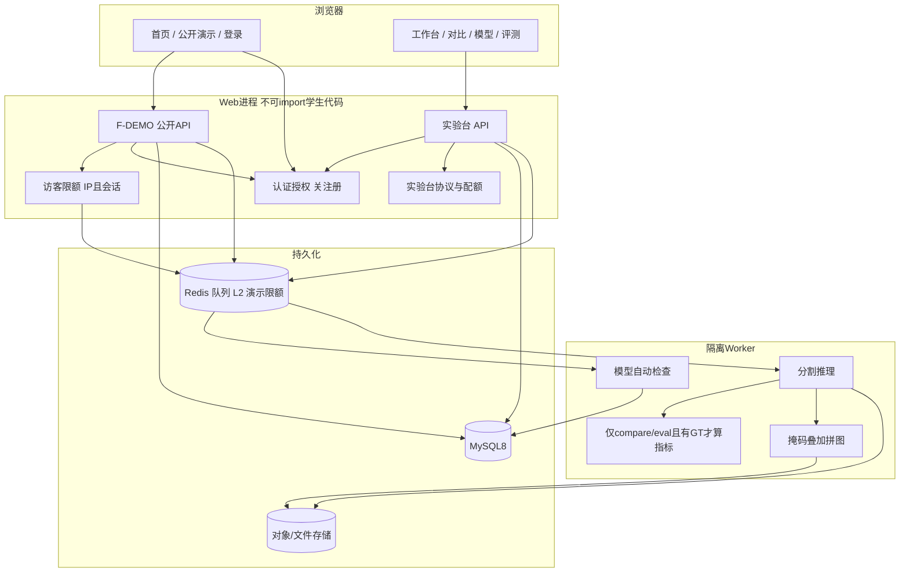
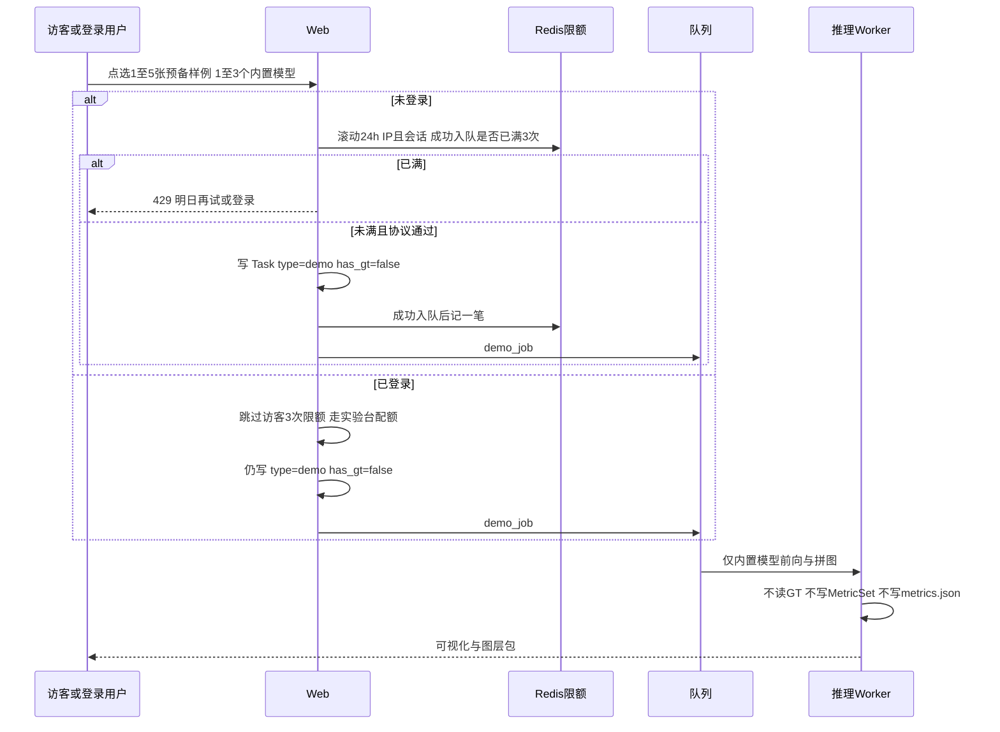
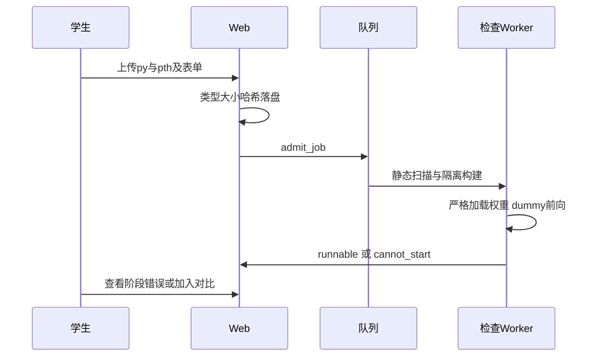
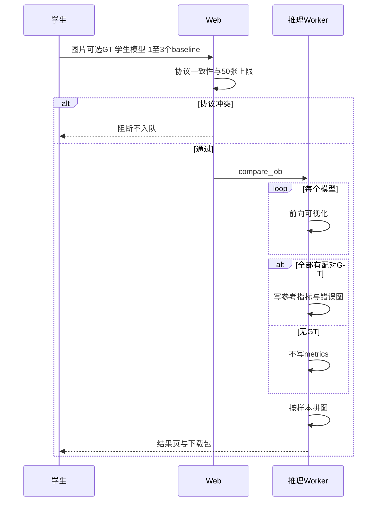
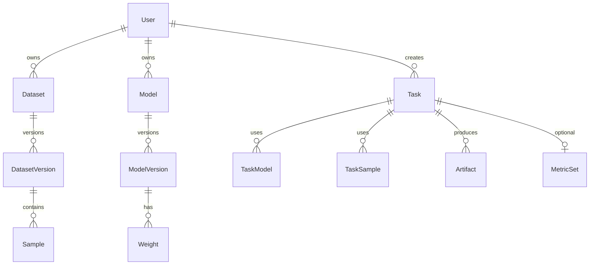

# 课题组工业缺陷分割科研平台概要设计书

文档状态：概要设计（实验台 Slice A–F 已落地；展示面尚未编码）  
版本：3.0  
日期：2026-09-18  
依据：[课题组网站需求分析书 v3.0](课题组网站需求分析书.md)（功能唯一事实源）  
配套：[课题组网站技术选型](课题组网站技术选型.md)

本文替代 v1.0（2026-09-14，依据需求 v2.0）中「`/` 即工作台、任务仅 compare/eval、必须登录才能推理、企业站完全不在范围」等结论。需求书 R-01～R-16 已冻结；未写入需求书的能力第一版不得自行扩展。

本阶段（H0）只改设计，不编码。容量、并发、时延目标仍为 UNKNOWN，实现前实测后再写入。

---

## 0. 相对代码现状与本版拍板

仓库已实现常驻实验台：FastAPI + Vue 3 + MySQL 8 + Redis/RQ + Docker 学生隔离；内置 CPU baseline 为 UNet / DeepLabV3+ / UNet++；正式评测仅 NEU-20。同事已将 `/` 改为免登录首页。下列与 v3.0 不一致，编码切片必须按本文改，而不是把演示做成「免登录的快速对比」：

- `Task.type` 仅 `compare | eval`，`creator_id` 非空；访客任务无处可挂。
- `create_compare_task` 在批次全部有 mask 时置 `has_gt=true`。NEU 样例带掩码，复用 compare 会算出精度。
- 全部 `/api/tasks/*` 依赖登录。**H1 已关闭** `POST /auth/register`，导师可开通/启停学生。

**本版已拍板（2026-09-18，用户确认）：**

1. 登录用户进入 `/demo` 仍走 **F-DEMO**：预备样例、无精度、不计访客 3 次限额；不改走快速对比。
2. 预备样例 = 已播种的 **NEU-20 全部 20 张**均可点选；每次任务仍为 1–5 张。
3. 先完成本文与技术选型对齐，再编码展示面（H1 起）。

硬禁令与需求书一致：无 `/train`、Web 不 `import` 学生 `.py`、无 GT 不算精度、公开演示即使磁盘有 GT 也不报任何精度、不改 `HomeView.vue` 综述正文、不另建企业站。

---

## 1. 设计目标与边界

把需求分析落成可实施的模块、数据对象、主流程和接口轮廓，使展示面编码不必回头猜需求。

产品是**一套双面常驻 CPU 网站**（R-01）：

- **展示面（免登录）**：综述首页（同事维护）+ 限次公开演示 + 登录。
- **实验台（须登录）**：导师开通学生后，导入 `.py+.pth`，与内置 baseline 对照、可选 NEU-20 正式评测。

设计必须遵守：

- 常驻网站；不做在线训练；不调用 `train_multi.py` / `train.py`。
- 公开演示与快速对比 **协议分离**：输入、限额、模型集合、指标策略均不得混用。
- 学生 `.py` 不在 Web 进程内执行；公开演示不执行学生代码。
- 无 GT 不产生精度字段。公开演示任务 **永久** `has_gt=false`，不写 `MetricSet`，不提供 metrics 接口。
- 无论文出图工作台；导出供 Draw.io 使用的 PNG 图层；图层包不含 `metrics.json` / PDF。
- 关闭公网自助注册；学生账号由导师开通。
- 不另建第二套企业网站；三档推荐、数据体检、基金报告仍后置。

未知项保持 UNKNOWN：用户规模、峰值并发、服务器型号、公网/内网、LLM 供应商、对象存储品牌、实验台并发/存储配额精确数字。访客演示限额数字已由需求冻结（24h 内 3 次成功入队），不是 UNKNOWN。

---

## 2. 架构选项与推荐

### 选项 A（推荐，已落地）：常驻模块化单体 + 同机隔离 Worker

```text
浏览器
  → Web 应用（展示面公开页 + 账号 + 实验台 API + 元数据）
  → 本地任务队列（Redis RQ）
  → Worker 进程/容器（模型检查、内置推理、评测、拼图；demo 只走内置路径）
  → 文件存储（图片、权重、可视化）
  → 关系库（用户、模型、任务元数据）
  → Redis db1（L2 缓存 + 访客演示滚动限额）
```

适用：课题组第一版、人数少、一台长期在线 CPU 服务器。展示面与实验台共用该拓扑，用角色与任务类型隔离，不拆第二套部署。

### 选项 B（备选）：Web 与 Worker 分机

Web 常驻；推理 Worker 可在有 GPU 的机器上。队列与对象存储必须持久化。  
适用：第一版之后接入 CUDA 模型。公开演示第一版只跑 CPU 内置三模型，不必为此拆机。

### 选项 C（拒绝）

把网站部署在 AutoDL 实例上。与 R-05 冲突。

**技术栈已冻结：** FastAPI + Vue 3 + MySQL 8 + Redis（RQ 队列与多级缓存）+ Docker 跑学生代码。详见技术选型。

---

## 3. 逻辑架构



信任边界：

- Web 只读写元数据与用户上传文件，不 `import` 用户 `.py`。
- 公开演示只跑平台审定的内置 CPU 模型，不进 student Docker。
- Worker 以非特权用户运行，无网络（第一版），只挂载本任务目录。
- 预置数据集只读；学生私有数据按 owner 隔离。
- 固定测试集 GT 不对普通学生、不对访客提供下载。演示公开 API 不返回 mask 字段。
- 访客不能枚举他人任务（含他人演示任务）。禁止「系统访客账号」：所有访客共用一个 User 会打穿任务隔离。

---

## 4. 模块划分

| 模块 | 职责 | 第一版 |
|------|------|--------|
| M-WEB | 页面与静态资源；首页综述由同事维护 | 必做；**不改 HomeView 综述正文** |
| M-DEMO | 公开演示：样例点选、内置模型、独立任务与结果页 | **必做（未编码）** |
| M-GUEST | 访客 `lab_demo_sid` cookie；IP+会话滚动限额 | **必做（未编码）** |
| M-AUTH | 登录会话；**关闭** `POST /register`；登录回跳 | 必做；须改造 |
| M-USER | 用户、配额、公告；**导师开通/启停学生** | 必做；开通为展示面验收项 |
| M-DATA | 数据集版本、校验、划分、预览；演示样例目录 | 实验台已有 NEU-20；演示目录须新增 |
| M-MODEL | 内置 baseline、学生导入、模型卡 | 已有；演示只暴露三模型白名单 |
| M-ADMIT | `.py+.pth` 自动检查状态机 | 已有 |
| M-TASK | 快速对比 / 正式评测 / **公开演示** 编排 | 须扩展 `type=demo` |
| M-INFER | 无 GT / 有 GT 推理 | 已有；demo 强制无 GT 路径 |
| M-METRIC | 仅实验台且有 GT 时写指标 | 已有；**禁止**为 demo 写行 |
| M-VIZ | 彩色掩码、叠加、边界、错误图、拼图 | 已有；demo 不生成 GT/错误图 |
| M-REC | 结果查询、再跑、分享、打包下载 | 实验台元数据已落库；页面 Slice G 不阻塞展示面 |
| M-AI | 基于当次对比/评测的分析 | 可后置；不把演示当正式精度结论 |
| M-PLACE | 检测/分类占位页 | 已有；访客点菜单须登录 |
| M-KB / M-PAPER | 知识库、顶刊检索 | 二期 |
| M-TRAIN | 在线训练 | **不实现** |

现有研究代码复用（封装进 `packages/infer` / `third_party`，不在网页进程改路径跑训练）：

- 内置网络与权重加载、着色、拼图
- 指标：`metrics_from_confmat`（**仅实验台**调用）
- 学生隔离：`packages/admit` 与 student Docker

必须新建或改造：公开演示协议与独立 API、预备样例公开目录、访客限额、关闭注册与导师开通、演示结果页（不得复用对比结果页的 metrics 请求）。

---

## 5. 页面结构

访客与已登录用户看到同一组**研究类**菜单；系统管理仅导师可见。侧栏底部未登录显示「访客」与「登录」，不显示「注册」。

| 路由意图 | 页面 | 说明 |
|----------|------|------|
| `/` | 首页 | **公开**；综述正文同事维护；本切片不改综述 |
| `/demo` | 公开演示 | **公开**；点选 1–5 张预备样例、勾选 1–3 个内置模型；无上传 |
| `/demo/:taskId` | 演示结果 | **公开但按任务授权**；原图/掩码/叠加/拼图；不渲染指标区 |
| `/login` | 登录 | **公开**；仅登录；成功后回 `redirect`（默认 `/`） |
| `/workbench` | 工作台 | 须登录；最近对比/评测，不把访客限次当主信息 |
| `/compare/new` | 新建快速对比 | 须登录；上传 ≤50 图、可选 GT、选模型 |
| `/compare/:taskId` | 对比结果 | 须登录；无 GT 不渲染精度区 |
| `/datasets` `/datasets/:id` | 数据集 | 须登录；第一版列表/详情可仍为弱实现 |
| `/models` `/models/import` `/models/:id` | 模型中心 | 须登录；访客不得列出学生私有模型 |
| `/eval/new` `/eval/:taskId` | 正式评测 | 须登录；仅 NEU-20 |
| `/records` | 结果记录 | 须登录；占位不阻塞展示面 |
| `/assistant` | 科研助手 | 须登录 |
| `/detection` `/classification` | 占位 | 须登录后可见说明；按钮不可提交 |
| `/admin` | 系统管理 | 仅导师；菜单对访客/学生不可见 |

无 `/train`。下载走授权 URL，不暴露存储绝对路径。

**登录回跳：** 侧栏无权限项与演示超限入口均进入 `/login?redirect=<原路径>`。已登录用户打开 `/login` 时应尊重 `redirect`（若合法且为本站相对路径），不要无条件打回首页。

**禁止：** 把 `CompareTaskView` 直接当演示结果页——该页会请求 `/tasks/:id/metrics`。

---

## 6. 核心流程

### 6.1 公开演示（F-DEMO，本版新增）

与 6.3 快速对比分离。禁止演示走 `POST /api/tasks/compare`。



入队前校验（失败 **不计入** 3 次成功限额，但须有独立防刷，见 §11.2）：

- 样例必须属于演示目录（NEU-20 的 20 张键），禁止上传、禁止外链、禁止任意 sample_id。
- 模型必须 1–3 个、去重，且 slug ∈ `{unet, deeplabv3, unetpp}`、`source=builtin`、`status=runnable`、`requires_cuda=false`。禁止学生模型。
- 登录用户发起的演示仍为 F-DEMO（无精度），只是不适用访客 3 次限额。

超限文案必须含「明日再试或登录」，并提供带 `redirect=/demo` 的登录入口。

单模型失败：任务可为 `partial_success`，列出失败项。

### 6.2 导入模型（实验台，已有）



状态：`uploaded → checking → runnable | cannot_start | retired`

`cannot_start` 必须带 `fail_stage`：`file` / `static` / `import` / `build` / `load` / `forward` / `shape` / `resource`。通过后不可加入公开演示。

### 6.3 快速对比（实验台，已有）



### 6.4 正式评测（实验台，已有）

与对比相同推理内核；数据源必须为 `kind=preset` 且 `is_fixed_test` 的 NEU-20；无掩码拒绝创建。全量 n=20 写指标；拼图按文件名排序抽 8 张。Disclaimer：NEU-20 不是论文完整 test split。学生下载该集 GT 为 403。

### 6.5 关闭注册与导师开通

- 登录页不提供注册 Tab。
- `POST /api/auth/register` 对任何调用方返回失败（建议 403，`code=REGISTER_DISABLED`），不得再创建 `role=student`。
- 导师在系统管理中开通学生：用户名 + 初始密码 + `role=student` + `status=active`；可启停。操作写入审计（操作者、时间、对象、原因）。
- 种子账号 `advisor` / `student` 仅本地 `.env`，不写进页面。

---

## 7. 逻辑数据模型

不绑定 SQL 方言。编码时用 Alembic 迁移（现有 `0001_initial` 之后新增一版，例如 `0002_demo`）。



`User ||--o{ Task` 表示登录用户可创建任务；**访客演示的 `creator_id` 为空**，用 `guest_sid` 标识，不要为此插入共享 User 行。

主要对象：

**User**：id、登录名、角色 `student|advisor`、状态 `active|disabled`、配额 JSON。不得自助注册。

**Dataset / DatasetVersion**：可见性 `preset|private|shared`、类别表 JSON、预处理协议 ID、是否固定测试集、是否禁止学生下载 GT、`kind`。

- 正式评测：现有 `name=NEU-20`，`kind=preset`，`is_fixed_test=true`，样本带 `mask_uri`。
- 公开演示目录：另建 `kind=demo_samples` 的版本，**20 条 Sample 与 NEU-20 同一组原图文件**（`asset:samples/neu/images/...`），`sample_key` 对齐；**`mask_uri` 必须为空**。这样即便误走 compare 的 `has_gt` 推断也不会给演示批次算精度。评测集行保持有掩码，互不覆盖。

**Sample**：version_id、sample_key、原图 URI、可选 mask URI、宽高、哈希。快速对比上传落入 `kind=upload_batch`。

**Model / ModelVersion**：`source=builtin|student`。公开演示可用集合 = builtin 且 slug 为 `unet` / `deeplabv3` / `unetpp` 且 runnable 且非 CUDA-only。显示名：UNet、DeepLabV3+、UNet++。

**Task**：

| 字段 | 约定 |
|------|------|
| type | `compare \| eval \| demo` |
| creator_id | 实验台非空；**demo 未登录可空** |
| guest_sid | 仅未登录 demo；对应 cookie `lab_demo_sid` |
| guest_ip_hash | 仅未登录 demo；`sha256(secret_key + client_ip)`，不存明文 IP |
| has_gt | compare 按批次；eval 恒 true；**demo 恒 false** |
| dataset_version_id | demo 指向 `demo_samples` 版本 |

须为 `guest_sid`、`type+created_at` 建索引，便于本任务授权与导师审计。

**TaskModel**：demo 只允许 `role=baseline`，禁止 `student_under_test`。

**MetricSet**：仅 `has_gt=true` 且 `type∈{compare,eval}` 时存在。**禁止为 `type=demo` 插行。** 也不接受「`available: false` 当作演示的 metrics 响应」——演示根本不提供该资源。

**Artifact**：demo 允许 `origin|pred_color|overlay|boundary|montage|bundle`；**不生成 `gt` / `error`**。

**Share / AuditLog**：访客演示任务不进入「分享给指定成员」。开通账号等管理操作写审计。

预处理协议 `PreprocessSpec` 独立成表。同一次 Task 只能引用一个 PreprocessSpec。演示与 NEU 内置模型共用现有 `neu_200`。

---

## 8. 学生模型插件契约（实现约束）

与现网一致。第一版单文件 `model.py` 必须提供：

```python
def build_model(num_classes: int, in_channels: int = 3, **kwargs):
    """返回 torch.nn.Module。kwargs 必须可忽略或显式报错。"""
```

或表单指定的 `ClassName(num_classes=, in_channels=)`。

`forward(x)`：`x` 为 `B,C,H,W` float；主输出为 `B,num_classes,h,w` logits。若返回 tuple，平台取第 0 项且须为四维 logits。

权重：优先 `state_dict`；完整 checkpoint 只读白名单键。内置模型走平台注册表。公开演示不加载该插件路径。

---

## 9. API 轮廓

统一：JSON；错误码含 `stage` 与 `code`。实验台资源先鉴权再按 owner / 分享 / 导师过滤。

### 9.1 认证与账号

| 方法 | 路径 | 说明 |
|------|------|------|
| POST | `/api/auth/login` | 登录，HttpOnly cookie `lab_session` |
| POST | `/api/auth/logout` | 登出 |
| GET | `/api/auth/me` | 当前用户；未登录 401 |
| POST | `/api/auth/register` | **须拒绝**（403 `REGISTER_DISABLED`） |
| POST | `/api/admin/users` | 导师开通学生 |
| PATCH | `/api/admin/users/:id` | 导师启停；第一版最小集 |

### 9.2 公开演示（独立前缀，不复用 compare）

未登录可调用目录与入队；读任务须持有该任务的 `lab_demo_sid`，或为该任务 `creator_id`，或为导师。

| 方法 | 路径 | 说明 |
|------|------|------|
| GET | `/api/demo/samples` | 20 张预备样例元数据；**无 mask / has_mask / GT URL** |
| GET | `/api/demo/models` | 仅三内置可运行模型 |
| POST | `/api/demo/tasks` | 入队；未登录走限额；body：`sample_keys`（1–5）、`baseline_version_ids`（1–3） |
| GET | `/api/demo/tasks/:id` | 状态与图层 URL；**响应不得含指标字段** |
| GET | `/api/demo/tasks/:id/file/...` | 授权后的图 |
| GET | `/api/demo/tasks/:id/bundle` | zip：拼图 + 单层 PNG + task.json |

明确不做：`GET /api/demo/tasks/:id/metrics`。若有人打到实验台 `/api/tasks/:id/metrics`，对 `type=demo` 应 404（建议 `code=DEMO_NO_METRICS`），即使调用者已登录。

超限：429，`code=DEMO_QUOTA`，消息含「明日再试或登录」。

协议失败：4xx（学生模型、非预备样例、数量越界等），**不计入**成功入队次数。

### 9.3 实验台（已有，保持）

| 方法 | 路径意图 | 说明 |
|------|----------|------|
| GET | `/api/me/dashboard` | 工作台 |
| POST | `/api/models/import` | 上传 py/pth |
| GET | `/api/models` `/api/models/:id` | 须登录 |
| POST | `/api/uploads/images` `/api/uploads/masks` | 快速对比；最多 50 |
| POST | `/api/tasks/compare` | 须登录；禁止由此创建 demo |
| POST | `/api/tasks/eval` | 须登录 |
| GET | `/api/tasks/:id` | 须登录；且不得向访客泄露 |
| GET | `/api/tasks/:id/metrics` | 无 GT 时 `{available:false}`；demo 见上 |
| GET | `/api/tasks/:id/bundle` | 图层包 |

占位页无对应 POST 任务接口。访客调用实验台接口 401。

---

## 10. 可视化产物约定

目录逻辑（存储内部，用户不可见绝对路径）：

```text
tasks/{task_id}/
  origin/{sample}.png
  gt/{sample}.png                 # 仅实验台有GT
  pred/{model_version_id}/{sample}.png
  overlay/{model_version_id}/{sample}.png
  boundary/{model_version_id}/{sample}.png
  error/{model_version_id}/{sample}.png   # 仅实验台有GT
  montage/{sample}__mask.png
  montage/{sample}__overlay.png
  montage/{sample}__error.png     # 仅实验台有GT
  metrics.json                    # 仅实验台有GT；demo 禁止出现
  task.json
```

拼图列顺序：

- 实验台无 GT：`origin | baselines… | student`
- 实验台有 GT：`origin | gt | baselines… | student`
- **公开演示：** `origin | 内置A | 内置B | …`（无 GT 列、无学生列）

颜色映射按任务类别表，全模型共用。演示页须标明「公开演示 / 预备样例 / 不代表测试集性能」。

`task.json`：模型名、version、权重哈希、preprocess_id、`has_gt`、任务 type、环境说明。demo 的 `has_gt` 必须为 false，且不得含 metrics 对象。

推理按 PreprocessSpec 缩放；拼图对齐到同一显示网格。禁止用全黑假 GT 走评测函数。demo Worker **不得读取** NEU-20 评测集上的 mask 文件来「内部算完再丢弃」——需求允许内部读取但不返回数字；本设计选择更严：演示批次 `mask_uri` 为空且 `run_demo` 不进入 metric/error 分支，避免漏写到 API 或缓存。

---

## 11. Worker、限额与隔离

### 11.1 Job 类型

RQ job：`admit`、`compare`、`eval`、**`demo`**（建议入口 `apps.worker.jobs.run_demo`）。

`run_demo` 可复用内置前向与拼图函数，但必须在入口强制：

- `score_gt = False`，不写 `metric_sets`，不写 `metrics.json`
- 不生成 `gt/`、`error/`
- 不调用 student Docker
- 模型集合再校验一遍三模型白名单

禁止给 `run_compare` 加一个「顺便当演示」的布尔开关作为唯一隔离——协议校验、授权、限额都在 Web 入队层，Worker 仍要按 `task.type` 硬分支，防止误入队。

入队同时在 MySQL 插入 Task；Worker 把终态写回 MySQL。Redis 挂了：新任务无法入队，历史结果仍从 MySQL + 磁盘读。

### 11.2 访客限额（Redis db1）

仅未登录。识别：**客户端 IP 与浏览器会话共同约束**（AND）。会话不能作为唯一钥匙。

- Cookie：`lab_demo_sid`（HttpOnly、SameSite=Lax、首次访问演示 API 时签发，与 `lab_session` 分离）。
- IP：取直连 peer；若部署在 Nginx 后，只信任本机反代的 `X-Forwarded-For` 最右一跳（实现时写成配置，防止伪造 IP 绕限）。
- 滚动 24 小时、最多 **3 次成功入队**。用 Redis ZSET，不要用 `INCR+TTL` 固定窗口：
  - `lab:demo:ip:{ip_hash}`
  - `lab:demo:sid:{guest_sid}`
  - member = task_id，score = unix 时间；入队成功后 ZADD；查询前 ZREMRANGEBYSCORE 去掉 24h 外；任一只 `ZCARD >= 3` 则拒绝。
- 清 Cookie：新 sid，但 IP 键仍生效。
- 登录用户：不读写上述 ZSET；演示次数不影响、也不被这 3 次限制。实验台配额数字仍 UNKNOWN，第一版至少沿用现有上传 50 张等已实现上限；演示每次 1–5 张不会碰到该上限。
- 防刷：协议失败不计入 3 次；另对 `POST /api/demo/tasks` 做每 IP 提交频率上限（具体数字编码时写入配置，需求未冻结，须有上限）。

限额状态可丢（Redis 可重建预期）：丢失后短期内可能多放行几次，不可把限额只放 MySQL 当第一版唯一实现——滚动窗口与清 Cookie 场景用 Redis 更直接。任务本身仍必须落 MySQL。

### 11.3 隔离

与现网相同：学生检查/推理 Docker、`--network=none`、只读挂载、可写仅输出。公开演示不执行学生代码。CUDA-only 模型不得进入演示目录；CPU 环境不得静默改用随机权重。

---

## 12. 科研助手（第一版设计要点）

Web 根据 **对比/评测** task 生成只读证据包。无 GT 时 `metrics: null`。助手无权限改 ModelVersion.status。

不把访客公开演示分析成「正式精度结论」。无 LLM 密钥时页面显示不可用，演示与对比主流程不受影响。

---

## 13. 质量属性（可观察，阈值 UNKNOWN）

| 场景 | 期望 |
|------|------|
| 导入恶意/错误 py | Web 不崩；cannot_start；无宿主文件被改 |
| 无 GT 对比 | 响应中无 mIoU/Dice/Acc 数值 |
| 公开演示 | 页面与 API 均无精度数字；无 MetricSet；bundle 无 metrics.json |
| 第 4 次访客入队 | 429，文案含「明日再试或登录」；清 Cookie 同 IP 仍拒 |
| 登录后再跑演示 | 成功且不消耗访客 3 次计数 |
| 改他人 taskId（含 demo） | 403/404 |
| 调用 register | 不能创建学生账号 |
| Worker 宕机 | 任务 queued/running 超时后 failed；首页与已完成演示/历史仍可读 |
| 部分模型 OOM | partial_success + 失败原因 |

---

## 14. 部署视图（第一版）

单机：Nginx → FastAPI → MySQL 8 + Redis + 磁盘；`lab-worker` 消费 RQ；学生任务进 Docker。展示面与实验台同一进程，靠路由与鉴权区分。

备份以 MySQL dump 与 `storage/` 为准。Redis：队列与演示限额、L2 缓存可丢；丢失限额不得导致「所有历史任务消失」。AutoDL 不出现在部署图中。

公网暴露时必须有登录才能进实验台；演示 API 虽免登录，但受限额与任务级授权，不得目录扫描他人 task id。密钥与种子密码只在环境变量。

---

## 15. 实现分期（相对仓库现状）

实验台行走骨架与对比/评测闭环（原 P0–P2，Slice A–F）**已经落地**，不要重做。

展示面编码切片（H0 之后，不动首页综述）：

| 切片 | 内容 | 验收 |
|------|------|------|
| **H0** | 本文 + 技术选型对齐 v3.0 | 本文件；不编码 |
| **H1** | 关注册；导师开通/启停学生 | AC-13 |
| **H2** | `demo_samples` 20 张目录 API；公开三模型列表 | AC-12 数据面 |
| **H3** | `type=demo`、`run_demo`、独立结果 API | AC-10 |
| **H4** | Redis IP∧会话滚动限额；登录用户跳过 | AC-11 |
| **H5** | `/demo` 页、侧栏、登录回跳 | AC-14；AC-16 不改首页结构 |
| **H6** | 单测 + demo 冒烟；回归 smoke_ac01～smoke_f | AC-01～09 不回退 |

H1 与 H2 可并行。H3 须在真实入队后才能测 H4。管理端「下架预备样例」第一版可用种子数据固定 20 张，不阻塞 AC-10～AC-16。

其后：Slice G 结果记录、数据集中心补全、F-ADM 配额与样例发布。二期：成果墙、合作意向、知识库、论文检索、可选 GPU Worker。检测/分类真任务、访客上传、企业站能力不做。

---

## 16. 编码前已拍板

1. Web：FastAPI；前端：Vue 3 + Vite + Element Plus。
2. 数据库：MySQL 8；迁移 Alembic。
3. 队列与 L2 / 演示限额：Redis；队列 RQ（db0），缓存与限额 db1。
4. 学生代码：Docker；内置模型：Worker 进程内推理（L1 缓存权重）。
5. 内置 baseline（与现码一致）：CPU 的 `unet`、`deeplabv3`、`unetpp`（显示名 UNet / DeepLabV3+ / UNet++）。公开演示只允许这三项。
6. 登录用户 `/demo` 仍为 F-DEMO，无精度。
7. 预备样例为 NEU-20 全 20 张可点选；每次任务 1–5 张。
8. 科研助手可后置；Slice G 不阻塞展示面。
9. 不改 `HomeView.vue` 综述正文。

---

## 17. 文档交付物

| 文件 | 用途 |
|------|------|
| [课题组网站需求分析书.md](课题组网站需求分析书.md) | 功能事实源（v3.0 已冻结） |
| 本文 | 模块、数据、流程、接口轮廓（v3.0） |
| [课题组网站技术选型.md](课题组网站技术选型.md) | 栈与 Redis/job 约定 |
| [../交接1.md](../交接1.md) | 进度与下一步；不替代需求书 |

历史「企业站独立产品 / 访客上传 50 张试用」不进入本仓库开工清单。恢复在线训练、公开注册、访客上传演示或另建企业站必须先升版需求书。

---

## 18. 修订记录

| 版本 | 日期 | 变更 |
|------|------|------|
| 1.0 | 2026-09-14 | 依据需求 v2.0：实验台闭环；`/` 为工作台；无公开演示。 |
| 3.0 | 2026-09-18 | 对齐需求 v3.0。新增展示面、F-DEMO 独立协议与 API、访客限额、关闭注册、导师开通、demo 数据模型。记录实验台已落地、展示面未编码。修正文档路径与 baseline 名称。 |
